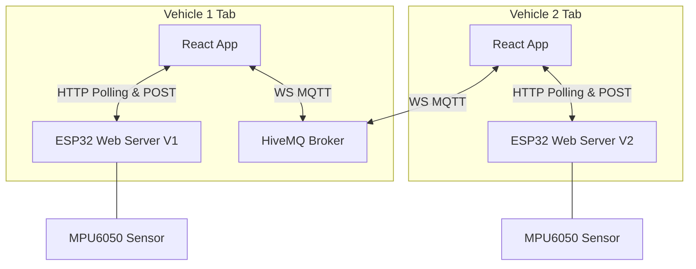

# 🛡️ V2V Shield: Real-Time Proximity-Aware Vehicle Communication System

V2V Shield is an advanced, full-stack vehicle-to-vehicle (V2V) proximity communication system. It integrates physical hardware (ESP32 controllers with MPU6050 accelerometers) and a React-based web dashboard to provide real-time status syncing, safety hazard detection, text-to-speech warnings, and spatial audio channels ("Proximity Voice Spaces") similar to Twitter Spaces.

---

## 🌐 IoT Protocols & Communication Models

V2V Shield employs a hybrid networking strategy to ensure low latency, minimal bandwidth overhead, and direct offline resilience.

```
┌─────────────────────────────────────────────────────────────┐
│                      HYBRID V2V STACK                       │
├──────────────────────────────┬──────────────────────────────┤
│    MQTT over WebSockets      │      Direct HTTP / REST      │
│      (Cloud Broker)          │     (Local Ad-hoc Wi-Fi)     │
├──────────────────────────────┼──────────────────────────────┤
│  • Peer Discovery            │  • Raw WAV Voice Messages    │
│  • Lat/Lng Coordinate Sync   │  • Low-level Hardware Alerts │
│  • State & Alert Broadcasts  │  • ESP32 Status Polling      │
└──────────────────────────────┴──────────────────────────────┘
```

### 1. Networking & IoT Protocols
* **MQTT over WebSockets (`ws://`)**:
  * **Protocol**: Message Queuing Telemetry Transport, a lightweight publish-subscribe protocol ideal for low-bandwidth, high-latency, or unstable networks.
  * **Transport**: Conducted over standard WebSocket port `8000` (`ws://broker.hivemq.com:8000/mqtt`) to bypass browser-native TCP socket restrictions, allowing the React frontend to communicate with HiveMQ.
  * **Usage**: Coordinates real-time vehicle positioning (latitude, longitude) and instantaneous alert state updates (e.g. falls, tilts).
* **HTTP/1.1 (RESTful Endpoints)**:
  * **Protocol**: Hypertext Transfer Protocol.
  * **Usage**: Used for point-to-point interactions between the local browser dashboard and the local ESP32 hardware server:
    * **Short Polling (`GET /data`, `GET /checkNewVoice`)**: Used by the local app instance to fetch raw accelerometer updates and check for incoming voice message notifications.
    * **Binary Payload Upload (`POST /voiceMessage`)**: Uploads standard multi-part form binary audio payloads directly to the ESP32 storage.
* **Direct Microcontroller-to-Microcontroller HTTP Client**:
  * **Protocol**: Direct ESP32-to-ESP32 GET requests (`/fall`).
  * **Usage**: In critical fall events, the hardware automatically makes a direct GET request to the peer ESP32's `/fall` IP endpoint over the local Wi-Fi subnet. This bypasses the cellular internet and the browser apps entirely, ensuring safety alerts trigger even if the user's phone dashboard is closed.

### 2. Communication Models
* **Publish-Subscribe (Pub/Sub Model)**:
  * Employs the public HiveMQ Broker. The browser client acts as a publisher/subscriber.
  * Vehicles broadcast discovery payloads (`v2v/discovery`) containing their ID, IP, and status. Nearby vehicles subscribe to this topic to automatically detect new peers without needing pre-existing static configuration.
* **Request-Response (Polling Model)**:
  * The local browser client polls the ESP32 web server at 2-second intervals.
  * Keeping the request-response model local to each vehicle minimizes the memory footprint on the ESP32, as it does not need to maintain resource-intensive WebSocket handshakes or persistent MQTT connections.
* **Simplex Push-to-Talk (PTT Model)**:
  * Half-duplex/simplex communication (one-way audio flow). The user holds down the mic button to record a WAV packet and releases to upload it. This guarantees that only one active audio stream is processed at a time, protecting hardware buffer bounds.

---

## 🎙️ Proximity Voice Spaces: Origin & Low-Bandwidth Engineering

```
    [Vehicle 1: Host] ─── ( 100 Meter Boundary ) ─── [Vehicle 2: Member]
            │                                                 │
            │ <── [MQTT Discovery: Lat/Lng & IP Exchange] ──> │
            │                                                 │
            └─────────────── [Direct Local Wi-Fi] ────────────┘
                      POST /voiceMessage (16kHz WAV)
```

### 1. Inspiration: Twitter Spaces for the Road
The "Spaces" tab in V2V Shield is inspired by social audio features like Twitter/X Spaces, adapted to solve a physical problem for drivers:
* **The Problem**: Drivers traveling in proximity (e.g., in a traffic jam, on the same highway stretch, or near a road hazard) often need to communicate vital safety details (debris on the road, black ice, sudden braking ahead) but have no secure, instant, or hands-free way to speak to surrounding cars.
* **The Solution**: An ad-hoc spatial intercom. Each vehicle automatically acts as the "Host" of its own physical space spanning a 100-meter radius. Any vehicle entering this physical boundary dynamically joins the space as a "Member." Communication is localized, automated, and ephemeral.

### 2. Low-Bandwidth & Network-Constraint Engineering
Vehicular environments often suffer from patchy cell coverage, packet dropouts, and high cellular data costs. V2V Shield is explicitly engineered to overcome these constraints:
* **Zero Cellular Data for Voice**:
  While lightweight metadata discovery happens over the MQTT broker (exchanging tiny ~100-byte JSON telemetry objects), **all high-bandwidth voice audio is transmitted peer-to-peer**. Audio files are posted directly to the target vehicle's local IP address over a local Wi-Fi or Ad-Hoc network, bypassing the internet entirely. This guarantees crystal-clear voice communication even in tunnels, mountain passes, or remote highways with zero cell service.
* **Optimized Audio Encoding**:
  Instead of streaming heavy, uncompressed, or complex stereo audio formats, the React app records mono audio downsampled to **16kHz** at **16-bit PCM** wrapped in a lightweight WAV container. This results in standard telephone-quality audio that produces tiny file footprints (e.g., 20KB–50KB for typical 3-second transmissions), ensuring packets transfer instantly over weak local connections.
* **Microcontroller Filesystem Queue**:
  The ESP32 firmware utilizes a SPIFFS (Serial Peripheral Interface Flash File System) partition. To accommodate the ESP32's limited SRAM (520KB), incoming audio is written directly to flash storage as `/receivedVoice.raw`. The simplex PTT model ensures only one voice file is stored and played back at any given time, preventing buffer overflows.

---

## 🚀 Core Features & Applications

### 1. Proximity Voice Spaces (Spatial Intercom)
* **Dynamic Geofenced Subnets**: Computes distances dynamically using the Haversine formula based on GPS coordinates. Each vehicle automatically broadcasts its active location to calculate overlap with the 100m communication boundary.
* **Host/Member Authorization**: Employs Twitter-like roles where the host controls the channel and members communicate back to the host, preventing cross-talk in overlapping traffic cells.
* **PTT Interface**: Implements a custom Push-to-Talk (PTT) interface with visual audio waveforms, recording voice on-the-fly and routing the binary payload directly to the targeted vehicle's receiver IP.

### 2. Live Telemetry & Safety Hazard Detection
* **MPU6050 Accelerometer Diagnostics**: The ESP32 hardware monitors gravity vectors, logging vehicle movement through three dynamic stages:
  * **Movement** (Threshold > 1500 units)
  * **Tilt** (Threshold > 3000 units)
  * **Fall** (Threshold > 6000 units)
* **Real-time Status Syncing**: Publishes local telemetry alerts immediately to the MQTT broker, triggering warning states on all active peer dashboards.

### 3. Safety Warning & Alarm Systems
* **Acoustic & Optical Alerts**: Fall alerts immediately flash the hardware status LED and sound a physical high-decibel buzzer siren to draw attention.
* **Voice Synthesis warnings (TTS)**: The React app uses the Web Speech API to synthetically read warning alerts aloud when peer vehicle status changes (e.g. *"Warning! Vehicle 2 fall detected!"*).

### 4. Proximity GPS Simulator
* **Interactive Range Control**: Includes an in-app simulation range slider (0m - 200m) to test geofenced boundaries, allowing developers to test entering, leaving, and communicating across spatial limits.
* **Simulation Logger**: Renders chronological status lists showing incoming data packets, local announcements, and networking diagnostics.

---

## 📐 System Architecture



---

## 🔌 ESP32 Firmware Endpoints (`esp32_fixed/esp32_voice_fix.ino`)

The ESP32 runs an asynchronous HTTP server (`ESPAsyncWebServer`) on port `8080`.

| Endpoint | Method | Description |
| :--- | :--- | :--- |
| `/data` | `GET` | Returns the current sensor message string (e.g. `"✅ Vehicle 2 stable."`, `"🔴 Vehicle 2 FALL DETECTED!"`). |
| `/fall` | `GET` | Triggered by a peer vehicle's ESP32 to notify a local fall. Instantly flashes the onboard LED and sounds the buzzer for 600ms. |
| `/voiceMessage` | `POST` | Receives raw binary WAV audio from the React app and saves it directly to SPIFFS as `/receivedVoice.raw`, setting `newVoiceAvailable = true`. |
| `/playVoice` | `GET`/`POST` | Serves the `/receivedVoice.raw` file as a WAV stream (GET) or accepts raw binary fallback audio (POST). |
| `/checkNewVoice` | `GET` | React app polls this. Returns `"yes"` if a new voice message was uploaded, reset flag, or `"no"`. |
| `/receivedVoice.raw` | `GET` | Serves the raw audio data stored in SPIFFS to the client. |

### 🛠️ ESP32 Hardware Integration details:
* **CORS Headers**: Appends global CORS headers to allow cross-origin requests (`Access-Control-Allow-Origin: *`) from any web browser tab.
* **MPU6050 Accelerometer**: Reads accelerometer values to detect deviation from baseline gravity:
  * **Movement**: Difference > 1500 units.
  * **Tilt**: Difference > 3000 units (LED flashes).
  * **Fall**: Difference > 6000 units (Buzzer sounds, alerts other ESP32 peer via HTTP request).

---

## 🚀 Setup & Testing Workflow

### 1. Web App Setup
Install dependencies and launch the dev server:
```bash
npm install
npm run dev
```

### 2. Physical Hardware Setup
1. Open `esp32_fixed/esp32_voice_fix.ino` in the Arduino IDE.
2. Install dependencies: `MPU6050`, `I2Cdev`, `AsyncTCP`, and `ESPAsyncWebServer`.
3. Set your Wi-Fi SSID and Password in the code:
   ```cpp
   const char* ssid = "YourWiFiSSID";
   const char* password = "YourWiFiPassword";
   ```
4. Set the IP of the opposite vehicle's ESP32 for direct hardware alerts:
   ```cpp
   String otherESP = "http://<OTHER_ESP32_IP>:8080/fall";
   ```
5. Connect your MPU6050 (SDA to Pin 21, SCL to Pin 22) and flash the ESP32.
6. Open the Serial Monitor to find the local IP address assigned to the board.

### 3. Testing Communication (2 Tabs)
1. Open two separate browser tabs at the local web app address (e.g. `http://localhost:5173`).
2. On **Tab 1**:
   * Navigate to **Settings**.
   * Set vehicle identity to **Vehicle 1**.
   * Enter Vehicle 1's ESP32 IP address and click **Connect**.
3. On **Tab 2**:
   * Navigate to **Settings**.
   * Set vehicle identity to **Vehicle 2**.
   * Enter Vehicle 2's ESP32 IP address and click **Connect**.
4. Both tabs will establish stable MQTT links. They will automatically exchange discovery coordinates and display each other's live connection status.
5. Navigate to **Spaces** in both tabs and use the range slider in **Settings** to simulate proximity:
   * **In Range (< 100m)**: Both Vehicle 1 and Vehicle 2 spaces will become active. Press and hold the mic button on either vehicle tab to record and transmit voice audio directly to the respective ESP32 receiver.
   * **Out of Range (> 100m)**: Voice spaces will automatically hide, showing vehicles as out of range.
